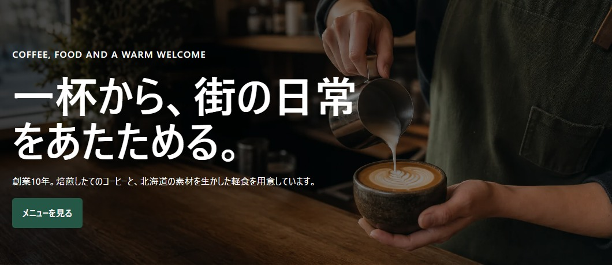
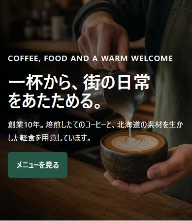

# DAY 9 もっとインパクトのある写真に

[目次](../student-workbook.md) · [共通手順](./common.md#local-git-workflow) · [前の回：DAY 8](./day08.md) · [次の回：DAY 10](./day10.md)

> ✉️ **佐藤さんからの依頼**  
> トップをもっとインパクトのある写真にしてください。  
> 来月のキャンペーン前には変えたいです。

👤 **依頼者：** 店舗責任者の佐藤さんです。  
👀 **見る人：** カフェのホームを初めて開くお客さまです。

🎯 **今回の課題:** 写真で何を伝えるかを佐藤さんに確認し、ホームの最初に見える大きな帯（ヒーロー領域）に写真を入れます。

🔧 **変える場所：** `hht/day09/css/style.css`の`.hero`と、そこで使う画像です。  
📌 **残すもの：** 見出し・説明文・「メニューを見る」ボタンと、そのリンク先です。

🏁 **完成の目安：** 写真で店の魅力が伝わり、パソコンでもスマホでも、見せたい部分が残って見出しが読めることです。

🧭 **作業前に考えること:** 「インパクト」が、コーヒーの手仕事を見せたいという意味なのか、店内の雰囲気を伝えたいという意味なのかを確かめます。  
被写体、見出しのために空けたい場所、避けたい表現、素材を使える範囲を質問します。

**今回学ぶこと:** 複数の背景の重ね方、写真の表示位置、Web用の画像形式です。

## 📂 このDAYのフォルダーを開く

[共通の開始手順](./common.md#independent-day-start)に沿って、前回の成果を保護してから教材を更新します。  
VS Codeで`Documents/edu`を開き、`hht/day09/index.html`と`hht/day09/css/style.css`を開きます。  
ブラウザで同じ`hht/day09/index.html`を開きます。  
DAY 9の作業は配布状態から始められます。


①の帯が写真を入れる場所です。  
②の見出しが写真の明るい部分と重なると、読みにくくなることがあります。

## 🛠️ 写真を選び、ホームに反映する

### ① 依頼を読み、候補を比べる

[依頼メール](../../fixtures/emails/02-hero-request.md)を読み、写真で何を伝えたいかを一文で質問します。  
たとえば「コーヒーをいれる様子と店内の雰囲気のうち、初めてのお客さまに一番伝えたいのはどちらですか」と聞けます。

[AI画像案](../../fixtures/photographer-delivery/hero-ai-master.png)と[模擬撮影データ](../../fixtures/photographer-delivery/simulated-shoot-001.jpg)を開き、見せたい部分、文字を重ねる場所、不自然に見える箇所を比べます。  
[素材台帳](../../fixtures/photographer-delivery/ASSET-MANIFEST.md)で出自と利用条件を確認し、候補を選んだ理由を書きます。  
AIで追加案を試した場合は、使った指示（プロンプト）も記録します。

💡 **ヒント：**
> 模擬撮影データは、AI画像案から作った納品・検収の練習用素材です。  
> 構図が似ていても、使える媒体や加工の範囲は素材台帳でそれぞれ確認します。

### ② Web用の画像を用意する

授業で使う画像変換ツールに選んだ元画像を読み込み、出力形式にWebPまたはAVIFを選びます。  
変換後の画像を`hht/day09/images/`へ保存します。  
変換前後の形式・ピクセル寸法・ファイル容量を記録し、画像の鮮明さと、300 KB以下という容量の目安を確かめます。

### ③ CSSで背景を差し替える

`css/style.css`で`.hero`を検索します。  
`background`の1つ目にある暗いグラデーションを残し、2つ目の色のグラデーションを画像の`url(...)`に置き換えます。  
`background`の次の行に`background-size`と`background-position`を追加します。

```css
background:
  linear-gradient(90deg, rgb(0 0 0 / 72%), rgb(0 0 0 / 18%)),
  url("../images/hero-cafe.webp");
background-size: cover;
background-position: center;
```

`hero-cafe.webp`は配布画像で表示を試す場合のファイル名です。  
自分で書き出した画像を使うときは、実際のファイル名に合わせます。  
保存してブラウザを再読み込みし、背景が写真に変わったことを確かめます。

💡 **ヒント：**
> `url(...)`の相対パスは、書き込んだCSSファイルの場所が基準です。  
> `css/style.css`から画像へ行くには、`../`で一つ上のフォルダーへ戻ります。

### ④ パソコンとスマホの幅で確かめる

DAY 8の営業時間と同じように、ブラウザの幅を変えて読みやすさを確かめます。  
今回は見出しとボタンに加え、見せたい被写体が表示範囲に残るかを見ます。





写真が切れるときは、`background-position`の横方向の値を変えて保存し、ブラウザで見比べます。  
この例では幅600ピクセル以下のときだけ、写真の位置を調整しています。

```css
@media (max-width: 600px) {
  .hero {
    background-position: center, 62% center;
  }
}
```

カンマの前がグラデーション、後ろが写真の位置です。  
自分の写真に合わせて値を調整します。  
**確認項目:** それぞれの幅で、見せたい部分が残り、文字が読めて、「メニューを見る」からメニューページが開くことを確かめます。

💡 **ヒント：**
> `cover`は枠を埋めるので、画像と枠の縦横比が違うと写真の一部が切れます。  
> この演習の背景画像には`background-position`を使います。  
> [写真配置の参考ページ](../../references/photo-layout.html)のように`img`で配置する場合は、`object-fit`と`object-position`で同じ考え方を試せます。


①のカップが②の縦長の枠にも残ることと、③の見出しが写真に埋もれず読めることを見ます。

### ⑤ 確認を依頼し、成果を保護する

佐藤さんへの返信案に、写真を選んだ理由、変えた場所、パソコンとスマホで確かめた結果を書きます。  
講師から確認用URLが用意されていれば、返信案に添えます。

**作業メモ:** 質問と回答、候補を選んだ理由、素材の利用条件、画像変換と表示の確認結果を残します。  
[共通の提出手順](./common.md#submission-policy)に沿って、制作ファイルと記録を教材の外に保護し、PRで提出します。

## ✅ 完成条件・証拠・発展課題

**入力:** 佐藤さんの依頼、支給された画像候補と素材台帳です。

**完成物:** 写真を差し替えたホーム、画像の比較・調整記録、佐藤さんへの返信案です。

**完成条件:**

- 写真で伝える内容、被写体、文字を置く場所、避けたい表現を確認している。
- 候補を比較し、採用理由と素材の出自・利用条件を記録している。
- WebPまたはAVIFに変換した画像を背景に入れ、300 KB以下を目安に容量と画質を確認している。
- パソコンでもスマホでも、見せたい部分が残り、文字が読めてボタンを使える。
- 見出しや案内の文章をHTMLに残し、先方へ確認してほしい点を返信案にまとめている。

**証拠:** 変換前後の形式・寸法・容量、パソコン幅とスマホ幅の画面、リンクの確認結果、返信案です。

**発展課題:** 写真を使わず、色・文字・余白で同じ店の魅力を伝える案を作り、写真の案と比べます。

[次の回：DAY 10](./day10.md)
