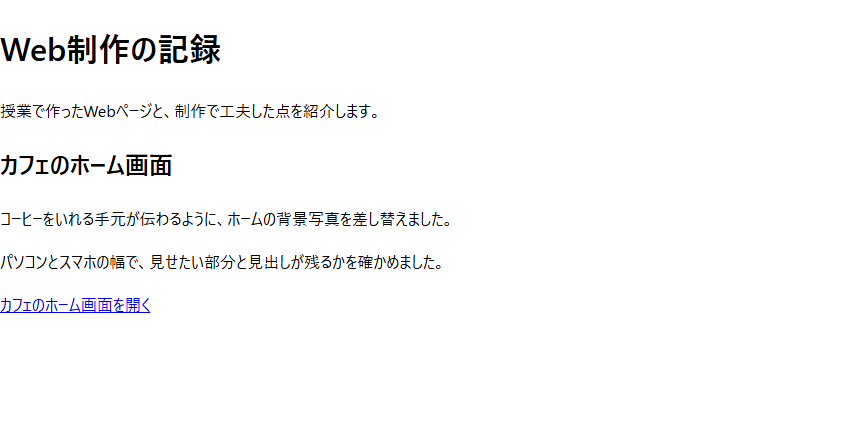

# DAY 10 伝える内容を決め、ベースを作る

<a id="day-10-スマホでボタンが押しにくい"></a>

[目次](../student-workbook.md) · [共通手順](./common.md#local-git-workflow) · [前の回：DAY 9](./day09.md) · [次の回：DAY 11](./day11.md)

> ✉️ **講師からの課題**  
> 自分が実際に作ったものや担当した作業を、初めて見る相手に紹介するページを作り始めましょう。

👤 **依頼者：** 講師です。  
👀 **見る人：** 先生やクラスメートなど、作品を見てもらいたい相手を一人思い浮かべます。

🎯 **今回の課題:** 相手に伝えたいことを決め、自分の短い紹介と作品・作業の説明をHTMLに書きます。

🔧 **変える場所：** 教材の外に置く自分の`portfolio`です。  
📌 **残すもの：** 教材の原本と、保護した練習成果です。  
掲載するファイルがあればコピーを使い、素材の利用条件と掲載してよい情報を確かめます。

🏁 **完成の目安：** ブラウザで紹介と作業内容が読め、必要なリンクを開けることです。  
保存した同じ作品をDAY 11で続けます。

**作業前に考えること:** 相手が作品を初めて見るとき、どんな説明があると自分の工夫を理解できるか考えます。

**今回学ぶこと:** 見出しと段落の使い分け、相対リンク、Gitによる作品の記録です。

## ① 見る相手と紹介する作業を決める

「誰に、何を伝えるか」を一文でメモします。  
続けて「何を頼まれたか」「自分は何を変えたか」「どう確かめたか」を書き出します。

たとえばDAY 8なら、営業時間を見つけやすくするために変えた箇所と、狭い画面での確認を説明できます。  
DAY 9なら、どの写真をなぜ選び、幅の違いで何を調整したかを説明できます。  
欠席などでその回の成果が手元にないときは、別の授業や自習で実際に取り組んだ作業を選び、文章から始めます。

💡 **ヒント：**
> 「カフェサイトを作った」と書くと、配布されたページまで自分で作ったように読めます。  
> 「ホームの背景を差し替え、狭い幅でカップが収まる位置を調整した」と、自分が担当した箇所を書くと工夫が伝わります。

## ② ひな型に見出しと文章を書く

教材は[共通の開始手順](./common.md#independent-day-start)で更新します。  
[作品の初回準備](./common.md#portfolio-start)に沿って、`Documents/portfolio`に白紙のひな型を用意し、作品側のGitを準備します。  
VS Codeのエクスプローラーで`portfolio`を開き、その中の`index.html`を選びます。

1. `header`内のコメントを目印に、ページ全体の見出しを`h1`、短い紹介を`p`で書きます。
2. `main`内の制作事例のコメントを目印に、紹介する作品や作業の名前を`h2`で書きます。
3. `h2`の下に、自分が変えたことと確認したことを`p`で書きます。
4. Ctrl+Sで保存し、`portfolio/index.html`をブラウザで開きます。  
   すでに開いているときは再読み込みします。

## ③ 必要なリンクを追加し、実際に開く

作品ファイルを見せる場合は、利用条件を確認してから、自分の編集済みファイルと表示に必要なCSS・画像を`portfolio/works/cafe/`などへそろえてコピーします。  
DAY 8のフォームを紹介するときは、練習用サーバーで確認した結果を文章や画面で示せます。  
POSTの受信確認には、DAY 8の練習用サーバーを使います。

コピー先に`works/cafe/index.html`がある場合は、紹介文の下に次のように書けます。

```html
<p><a href="works/cafe/index.html">カフェのホーム画面を開く</a></p>
```

**確認項目:** 保存してページを再読み込みし、紹介と作業内容が読めることを確かめます。  
リンクを置いた場合はクリックし、意図したページが開いて、CSSや画像も表示されることを確かめます。



💡 **ヒント：**
> `href`に書く相対パスは、そのリンクを書いたHTMLからたどる道順です。  
> この例では`portfolio/index.html`から`works`、`cafe`と順に進みます。

## ④ 確認結果を記録し、次回につなぐ

VS Codeの「ソース管理」で差分を開き、作品に残すファイルを確認します。  
[作品を記録する手順](./common.md#day1015同じ作品を記録して続ける)に沿って作品側でコミットします。  
**作業メモ:** 見る相手、今回変えた箇所、確認結果、次回直す所、コミットSHAを書きます。  
提出は[全DAYのPR提出手順](./common.md#submission-policy)に沿って進めます。

## ✅ 完成条件・証拠・発展課題

**入力:** 紹介したい作品や作業のメモと、白紙のHTMLひな型です。

**完成物:** 自分の紹介と作業内容を書いたHTMLのベース、確認結果と次回に向けた作業メモです。

**完成条件:**

- 誰に何を伝えるページかを説明できる。
- 短い紹介と、自分が実際に担当した作品や作業をHTMLに書き、ブラウザで読めることを確認している。
- リンクを追加した場合は実際に開き、リンク先の表示を確認している。
- 教材の外にある作品をGitで記録し、確認結果とDAY 11で続ける箇所を残している。

**証拠:** ブラウザの表示、変更差分、リンクを置いた場合はその確認結果、作業メモとコミットSHAです。

**発展課題:** 表示幅を変えるか、キーボードでリンクをたどり、気づいた改善点を一つ試します。  
装飾や動きの追加、相互レビュー、外部公開、発表は必須にしません。

## 参考資料

[旧DAY10の技術資料](../legacy-workbook/day10.md)は、表示幅やボタンの確認を試したいときに参照できます。

[次の回：DAY 11](./day11.md)
